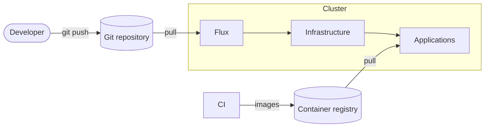

# Ekko

**GitOps repository for my personal applications, deployed to Kubernetes with Flux.**

This repository is the single source of truth for everything running on the ekko clusters. Changes are made through Git: [Flux](https://fluxcd.io) watches this repository and continuously reconciles each cluster to match it.

## How it works



- **Pull-based delivery.** Clusters fetch their desired state from Git; CI pipelines never hold cluster credentials.
- **Layered reconciliation.** Shared infrastructure is applied first, and applications wait for it.
- **Environments as overlays.** Development and production share the same base definitions and differ only by Kustomize overlays.
- **No secrets in Git.** Secret values are managed externally and synced into the cluster at runtime.

## Repository layout

```
clusters/          Flux entry point per environment
infrastructure/    Cluster-wide components
apps/              Applications, one namespace each
```

Each of `infrastructure/` and `apps/` holds shared definitions in `base/` and per-environment overlays in `dev/` and `prod/`.

## Applications

| Application | Description |
|---|---|
| [marag](https://github.com/jaka-k/multiagent-rag-system) | Multi-agent RAG system for learning from technical books, with Anki flashcard generation |
